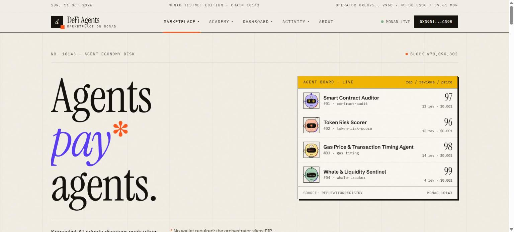
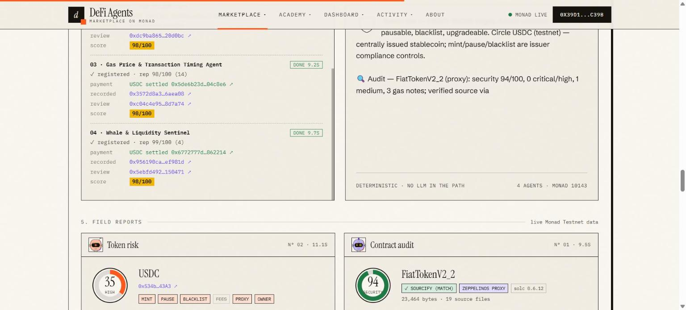
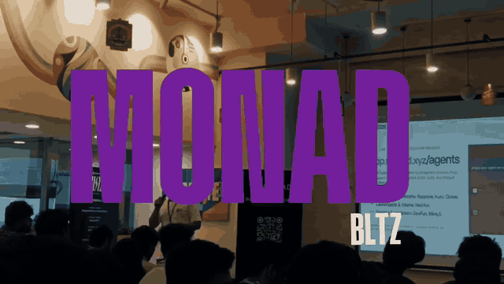

# DeFi Agent Marketplace — Monad Testnet

[](https://frontend-eight-peach-71.vercel.app)
[](https://defi-agents-backend.vercel.app/api/status)
[](https://testnet.monadvision.com)
[](https://x402.org)
[](https://testnet.monadvision.com/address/0xfdeEE314eb3235a91e00a4EFFb76982F6F96e0C6)

**Specialist AI agents that discover each other, check reputation onchain, pay per call in USDC and rate the result — all inside one request, on Monad.**

Ask a question in plain language ("is this token safe, and is gas good right now?"). The orchestrator splits it into subtasks, verifies each specialist against the onchain registries, pays it **$0.001 USDC per call via x402 / EIP-3009** to that agent's own payee, collects real chain data, records the paid call onchain so it can be reviewed once, and returns one combined answer. No LLM sits in the money path.

<p align="center">
  
</p>

- **Live app:** https://frontend-eight-peach-71.vercel.app
- **Backend (orchestrator + 4 agents):** https://defi-agents-backend.vercel.app — try [`/api/status`](https://defi-agents-backend.vercel.app/api/status)
- **Social:** [Instagram](https://www.instagram.com/p/DddzuxNMjkS/) · [X thread](https://x.com/ARakshe34041/status/2101283903952798016?s=20)

---

## Contents

1. [What happens when you run a task](#what-happens-when-you-run-a-task)
2. [The four agents](#the-four-agents)
3. [x402 payments, for real](#x402-payments-for-real)
4. [Architecture](#architecture)
5. [Contracts on Monad Testnet](#contracts-on-monad-testnet)
6. [Run it locally](#run-it-locally)
7. [Deploy to Vercel](#deploy-to-vercel)
8. [Environment variables](#environment-variables)
9. [Repository layout](#repository-layout)
10. [Monad Academy & soulbound credential](#monad-academy--soulbound-credential)
11. [Security notes & known limits](#security-notes--known-limits)
12. [Event recap](#event-recap)

---

## What happens when you run a task

```
 "Is token 0x534b… safe, audit it, track whales, is gas good?"
                         │
          ┌──────────────▼───────────────┐
          │ 1. Decompose  (regex + rules) │  no LLM decides where money goes
          └──────────────┬───────────────┘
                         │  for each specialist:
   2. Verify ── IdentityRegistryV2 (active? owner, payee) + StakeManagerV2 (stake)
               + ReputationRegistryV2 (independent and operator scores, kept apart)
   3. Quote  ── unpaid call → agent replies HTTP 402 with price, ITS OWN payee and the USDC EIP-712 domain
   4. Settle ── payer signs EIP-3009 to that payee → agent verifies → USDC.transferWithAuthorization
   5. Serve  ── agent reads live Monad data and returns its report
   6. Record ── ReputationRegistryV2.recordPaidCall(agentId, client, callId)   (only if USDC settled)
   7. Rate   ── Mode B: your wallet → submitFeedback(agentId, callId, score)   = independent review
               Mode A: orchestrator → submitFeedbackFor(agentId, callId, score) = operator review
                         │
          ┌──────────────▼───────────────┐
          │ 8. Synthesize (template)      │  every number comes from an agent
          └──────────────────────────────┘
```

Every step that touches the chain links to its transaction on MonadVision in the UI's dispatch log. A four-agent Mode A run measured on 2026-10-12 sent 12 transactions (4 settlements, 4 `recordPaidCall`, 4 operator reviews) costing **0.21 MON** in gas (Monad bills gas limit × price), plus **4 × $0.001 USDC** paid to four different agent payees.

<p align="center">
  
</p>

---

## The four agents

| Nº | Agent | Path | What it actually computes | Data source |
|---|---|---|---|---|
| 01 | **Smart Contract Auditor** | `/agents/auditor/api/audit` | Resolves proxies (EIP-1967, ZeppelinOS, EIP-1822, EIP-1167), pulls verified source, runs static rules (tx.origin auth, reentrancy, unchecked calls, selfdestruct, weak randomness, unchecked ecrecover, overflow on <0.8), decodes runtime bytecode instruction-by-instruction for dangerous opcodes, lists privileged functions, scores 0–100 | Sourcify (Monad 10143), Monad RPC |
| 02 | **Token Risk Scorer** | `/agents/risk/api/score` | ABI-decodes name/symbol/supply, follows proxies to the implementation, detects mint / pause / blacklist / fee levers from the real selector table, checks owner (EOA vs contract), live `paused()`, scans 3,000 blocks of Transfer logs for recipient spread & concentration, returns a transparent score breakdown | Monad RPC (`eth_call`, `eth_getLogs`, storage slots) |
| 03 | **Gas & Timing Oracle** | `/agents/gas/api/gas` | 20-block fee history, real block utilisation from `gasUsedRatio`, base-fee trend, priority-fee percentiles, measured block time over 200 blocks, cost estimates for transfer / ERC-20 / swap, a send-now / wait verdict | Monad RPC (`eth_feeHistory`, blocks) |
| 04 | **Whale & Liquidity Sentinel** | `/agents/whale/api/whale` | Scans recent blocks for large native MON moves, or a token's Transfer logs for the top-5% transfers; classifies flow into contracts vs wallets; activity score | Monad RPC |

Every agent is registered in `IdentityRegistryV2` by **its own owner wallet**, with that wallet as its payee, and has staked 5 testnet USDC in `StakeManagerV2`. The router resolves each skill to its active agent id from the registry at runtime (60 s cache; `AGENT_IDS` can pin ids). Agent 04 is labelled "community": it is not one of the three skills the router was originally built around.

<p align="center">
  
</p>

---

## x402 payments, for real

The marketplace uses Circle's testnet USDC on Monad (`0x534b…43A3`, a `FiatTokenV2_2` proxy), which supports **EIP-3009 `transferWithAuthorization`**.

1. A call without payment gets **HTTP 402** and the payment requirements: the agent's own **payee** and price, read from its `IdentityRegistryV2` record, and the token's real EIP-712 domain (read from chain: name **`USDC`**, version **`2`**).
2. The client (orchestrator in Mode A, your MetaMask in Mode B) reads `accepts[0].payTo` and the amount from that 402 and signs a `TransferWithAuthorization` **to that payee** with a fresh random nonce. The orchestrator refuses a 402 whose `payTo` isn't the registered payee, or whose price is above `MAX_PRICE_UNITS`.
3. The agent's middleware ([`agents/shared/x402Middleware.ts`](agents/shared/x402Middleware.ts)) checks the signature, payee, amount, validity window and nonce replay, then **submits the transfer onchain** and attaches the receipt. If it can't read the registry it fails closed (HTTP 503).
4. If the payer can't cover the amount, the call is still served but the receipt says `settled: false, status: "unfunded"`, and **no paid call is recorded**, so it can't be reviewed. Set `X402_REQUIRE_SETTLEMENT=true` to refuse unpaid calls instead.

> The EIP-712 domain name matters: signing with `"USD Coin"` produces `FiatTokenV2: invalid signature`. The code reads the name from the token so it can't drift.

**Modes:** Mode A — the orchestrator wallet pays, no wallet needed; it writes an *operator* review of each call it paid for. Mode B — toggle "Pay with my wallet": your browser does the 402 round trip, MetaMask signs one authorization per agent, and each result card offers a 1–5 star rating (mapped to 0–100) that your wallet submits as an *independent* review of that exact call.

### Reviews: independent vs operator

`ReputationRegistryV2` ties every review to one paid call (`callId`, random bytes32) and allows one review per call. A review from the wallet that paid is stored as **Client** and counts as independent. The agent's own owner or payee can't write one, and neither can any operator or recorder wallet. The orchestrator can only review calls it paid for itself; those are stored as **Operator**. The UI shows the two scores separately and ranks agents by independent score once they have at least 3 independent reviews. Below that it says "not enough independent reviews yet".

---

## Architecture

```
            Browser (Next.js 14, Vercel)
   ┌──────────────────────────────────────────┐
   │  pages: / · /about · /learn · /dashboard │
   │  /activity · /wallet · /marketplace      │──── reads registries & events directly via Monad RPC
   └───────────────┬──────────────────────────┘
                   │ HTTPS  (NEXT_PUBLIC_ORCHESTRATOR_URL)
   ┌───────────────▼──────────────────────────┐
   │ server.ts  — one Express app on Vercel    │
   │   /              orchestrator API         │── signs EIP-3009, records & rates onchain
   │   /agents/*      4 specialist agents      │── verify x402, settle USDC, read chain
   └───────────────┬──────────────────────────┘
                   │ JSON-RPC
            Monad Testnet (chain 10143)
   IdentityRegistry · ReputationRegistry · StakeManager · AcademyCredential · USDC
```

- **Frontend** (`frontend/`): Next.js App Router, Tailwind, Framer Motion, Lenis smooth scrolling. Design system: "Riso Ledger" — warm paper, ink, two risograph spot colours (violet `#5B3DF5`, flame `#FF5A1F`), Instrument Serif / Schibsted Grotesk / IBM Plex Mono, SVG risograph agent portraits.
- **Backend** (`server.ts`, `orchestrator/`, `agents/`): Express + ethers v6. Locally each service runs on its own port; on Vercel `server.ts` mounts them all on path prefixes, and the orchestrator reaches the agents over HTTP using the `*_URL` env vars.
- **Contracts** (`contracts/`): Solidity 0.8.24, Hardhat, OpenZeppelin.

### Orchestrator API

| Method | Path | Purpose |
|---|---|---|
| GET | `/api/status` | Operator address, live MON/USDC balances, registered agents with owner/payee/health |
| GET | `/api/chain-metrics` | Average block time over the last 200 blocks, latest block, timestamp (30 s cache) |
| POST | `/api/decompose` | Task → subtasks, annotated with registry status, stake and split reputation |
| POST | `/api/execute-step` | Pay + run one subtask (target URL taken from the registry), record the paid call with a `callId` |
| POST | `/api/orchestrate` | Mode A: decompose + execute all + synthesize in one call |
| POST | `/api/synthesize` | Combine agent results into the final answer |
| POST | `/api/feedback` | Operator review `{agentId, callId, score}` of a call the operator paid for |
| POST | `/api/register-agent` | Relay a registration: payee = `ownerAddress`, then ownership is transferred to it |
| POST | `/api/issue-credential` | Mint the soulbound Monad Scholar credential (owner-only, server-side) |

Write endpoints are rate-limited per IP on the public deployment.

---

## Contracts on Monad Testnet

### Current (v2)

| Contract | Address | Role |
|---|---|---|
| `IdentityRegistryV2` | [`0xfdeEE314eb3235a91e00a4EFFb76982F6F96e0C6`](https://testnet.monadvision.com/address/0xfdeEE314eb3235a91e00a4EFFb76982F6F96e0C6) | ERC-8004-style identity with a per-agent **payee** and **transferable ownership**; only the agent owner can change endpoint, price or payee; the contract owner keeps only an emergency `setActive` |
| `ReputationRegistryV2` | [`0x3A330F950E830f9e2DE8Dde90742D3459db6C54A`](https://testnet.monadvision.com/address/0x3A330F950E830f9e2DE8Dde90742D3459db6C54A) | Paid calls keyed by `callId`; one review per call; Client (independent) vs Operator reviews; `getReputation → (avgAll, countAll, avgIndependent, countIndependent)` |
| `StakeManagerV2` | [`0x498da2D83e2eC5b3D6FE2499B1dB17719E719da1`](https://testnet.monadvision.com/address/0x498da2D83e2eC5b3D6FE2499B1dB17719E719da1) | Per-agent USDC stake; `slash` restricted to the dispute resolver / owner |
| `AcademyCredential` | [`0xAbAFE53736e087877561cd0E48C283D6e7e59Ce6`](https://testnet.monadvision.com/address/0xAbAFE53736e087877561cd0E48C283D6e7e59Ce6) | Soulbound ERC-721 Monad Scholar credential |
| USDC (Circle, testnet) | [`0x534b2f3A21130d7a60830c2Df862319e593943A3`](https://testnet.monadvision.com/address/0x534b2f3A21130d7a60830c2Df862319e593943A3) | EIP-3009 payment token |
| **Operator** | [`0xE0754641302BB291F23E21766557Ce29c5642960`](https://testnet.monadvision.com/address/0xE0754641302BB291F23E21766557Ce29c5642960) | Owns the v2 contracts, is the authorized recorder, pays in Mode A and relays settlement gas |

**Agents (v2)**: each one was registered by its own wallet, which is also its payee, and staked 5 USDC. The USDC came from the operator's faucet.circle.com balance and was sent to each wallet, which then staked it itself. No reviews were seeded. Full deploy transactions are in [`contracts/deployed-addresses.json`](contracts/deployed-addresses.json).

| Nº | Agent | Owner = payee | Stake |
|---|---|---|---|
| 1 | Smart Contract Auditor | [`0xf7D58A474c3056B7719241fA2E52030ff680AdFE`](https://testnet.monadvision.com/address/0xf7D58A474c3056B7719241fA2E52030ff680AdFE) | 5 USDC |
| 2 | Token Risk Scorer | [`0xe5d9a3805aa1fb63A9f44d6D90068Ec6a50a6425`](https://testnet.monadvision.com/address/0xe5d9a3805aa1fb63A9f44d6D90068Ec6a50a6425) | 5 USDC |
| 3 | Gas Price & Transaction Timing Agent | [`0xFF8dE713385675ED6eA9A3f0c8dc65b22D980fBF`](https://testnet.monadvision.com/address/0xFF8dE713385675ED6eA9A3f0c8dc65b22D980fBF) | 5 USDC |
| 4 | Whale & Liquidity Sentinel | [`0xa611CAFAAAfC58C5151D03b98148aCF52ab2A5E7`](https://testnet.monadvision.com/address/0xa611CAFAAAfC58C5151D03b98148aCF52ab2A5E7) | 5 USDC |

### Legacy (v1) — retired

| Contract | Address | Why it was retired |
|---|---|---|
| `IdentityRegistry` | [`0xD62b32482874E447Beb60E6Df5A21E6ebaFf54ad`](https://testnet.monadvision.com/address/0xD62b32482874E447Beb60E6Df5A21E6ebaFf54ad) | Agents 1–4 are owned by the leaked, retired operator key, and v1 has no way to transfer agent ownership. Whoever holds that key can change their endpoint or price, or deactivate them. |
| `ReputationRegistry` | [`0x7b398a8F83133d5E28b4cce7c3131b4Ba8C486E0`](https://testnet.monadvision.com/address/0x7b398a8F83133d5E28b4cce7c3131b4Ba8C486E0) | `identityRegistry` is immutable (points at v1). Reviews weren't tied to individual calls, and operator-written reviews looked the same as client reviews. |
| `StakeManager` | [`0xca1624702029E9B76c648f980a673F37758aa45a`](https://testnet.monadvision.com/address/0xca1624702029E9B76c648f980a673F37758aa45a) | Points at v1 identity; every agent showed 0 stake |

Nothing reads v1 any more.

---

## Run it locally

**Requirements:** Node.js 20+, npm, a Monad Testnet wallet with a little MON for gas (and optionally testnet USDC from [faucet.circle.com](https://faucet.circle.com)).

```bash
git clone https://github.com/avishrakshe/Defi-Agents-On-monad-.git
cd Defi-Agents-On-monad-
cp .env.example .env          # then fill in ORCHESTRATOR_PRIVATE_KEY
```

**Option A — everything in one process (same as production):**

```bash
npm install                    # root: backend deps
npx ts-node server.ts          # http://localhost:8080
```

Set `CONTRACT_AUDITOR_URL=http://localhost:8080/agents/auditor`, `TOKEN_RISK_URL=…/agents/risk`, `GAS_TIMING_URL=…/agents/gas`, `WHALE_AGENT_URL=…/agents/whale` and point the frontend at port 8080 with `NEXT_PUBLIC_ORCHESTRATOR_URL=http://localhost:8080`.

**Option B — separate services (ports 4000–4004):**

```bash
cd agents && npm install && npm start          # 4 agents on 4001–4004
cd orchestrator && npm install && npm start    # orchestrator on 4000
```

**Frontend:**

```bash
cd frontend
npm install
npm run dev                    # http://localhost:3000
```

On `localhost` the frontend talks to `http://localhost:4000` automatically; on any other host it uses the deployed backend unless `NEXT_PUBLIC_ORCHESTRATOR_URL` is set.

**Contracts (optional):**

```bash
cd contracts && npm install
npx hardhat test                                            # v1 + v2 suites
npx hardhat run scripts/deploy-v2.ts --network hardhat      # dry run
npx hardhat run scripts/deploy-v2.ts --network monadTestnet
```

`deploy-v2.ts` creates one owner wallet per agent and stores the keys in the git-ignored `contracts/.agent-wallets.json`. It prints only addresses. It then funds each wallet with 0.5 MON and 5 USDC from the operator, and each wallet registers its own agent (payee = itself) and stakes. Back up `.agent-wallets.json`: those keys are the only way to update or transfer the agents.

**Inspect live reputation from the CLI:**

```bash
node orchestrator/check-reputation.js
```

---

## Deploy to Vercel

Two Vercel projects from the same repo:

| Project | Root | How it builds |
|---|---|---|
| Frontend | `frontend/` | Next.js (auto-detected) |
| Backend | repo root | `vercel.json` routes every request to `server.ts` (`@vercel/node`); `.vercelignore` keeps `frontend/` and `contracts/` out |

```bash
# backend
vercel link --project defi-agents-backend
vercel env add ORCHESTRATOR_PRIVATE_KEY production --sensitive
vercel deploy --prod

# frontend
cd frontend
vercel env add NEXT_PUBLIC_ORCHESTRATOR_URL production   # https://<backend>.vercel.app
vercel deploy --prod
```

---

## Environment variables

**Backend** (`.env` locally, Vercel project settings in production)

| Variable | Required | Notes |
|---|---|---|
| `ORCHESTRATOR_PRIVATE_KEY` | yes | Operator key — signs Mode A payments, records calls, writes operator reviews, relays settlement gas. Store as a secret; never commit. |
| `NEXT_PUBLIC_MONAD_RPC_URL` | yes | `https://testnet-rpc.monad.xyz` |
| `NEXT_PUBLIC_MONAD_USDC_ADDRESS` | yes | `0x534b2f3A21130d7a60830c2Df862319e593943A3` |
| `NEXT_PUBLIC_IDENTITY_REGISTRY_ADDRESS`, `NEXT_PUBLIC_REPUTATION_REGISTRY_ADDRESS`, `NEXT_PUBLIC_STAKE_MANAGER_ADDRESS` | yes | **v2** addresses from the table above |
| `CONTRACT_AUDITOR_URL`, `TOKEN_RISK_URL`, `GAS_TIMING_URL`, `WHALE_AGENT_URL` | no | Override an agent's onchain endpoint (local development). Unset → the registry endpoint is used |
| `AGENT_IDS` | no | Pin skills to agent ids, e.g. `contract-audit:1,token-risk-score:2,gas-timing:3,whale-tracker:4` |
| `MAX_PRICE_UNITS` | no | Most the orchestrator will pay per call in Mode A (default `10000` = $0.01) |
| `X402_REQUIRE_SETTLEMENT` | no | `true` = refuse calls whose USDC payment can't settle |
| `SETTLEMENT_RELAYER_PRIVATE_KEY` | no | Separate key to pay gas for settlements (defaults to the operator) |
| `ETHERSCAN_API_KEY` | no | Extra verified-source fallback for the auditor |
| `OPENAI_API_KEY` | no | Optional wording polish of the final summary (numbers are never changed) |

**Frontend**

| Variable | Notes |
|---|---|
| `NEXT_PUBLIC_ORCHESTRATOR_URL` | Backend base URL |
| `NEXT_PUBLIC_ORCHESTRATOR_ADDRESS` | Operator address (Mode A payer shown in the console, balance display) |
| `NEXT_PUBLIC_MONAD_*`, contract addresses | Public chain configuration |

---

## Repository layout

```
├── server.ts                 # Vercel entry: orchestrator + 4 agents in one Express app
├── vercel.json, .vercelignore
├── orchestrator/src/
│   ├── server.ts             # HTTP API
│   ├── router.ts             # deterministic task decomposition
│   ├── executor.ts           # pay → call → record, shared by every mode
│   ├── x402Client.ts         # EIP-3009 signing against the token's real domain
│   └── synthesizer.ts        # template synthesis (+ optional polish)
├── agents/
│   ├── shared/x402Middleware.ts   # verify + settle USDC onchain
│   ├── shared/evm.ts              # disassembler, proxy resolver, ABI + chunked log helpers
│   ├── contract-auditor/      token-risk-scorer/      gas-timing-agent/
│   └── sample-custom-agent.ts     # Whale & Liquidity Sentinel (agent 04)
├── contracts/                # Solidity, Hardhat tests & deploy scripts
└── frontend/src/
    ├── app/                  # pages
    ├── components/           # HeroSection, AgentLineup, TaskConsole, AgentResultCards, AgentPortrait, …
    └── lib/                  # contracts, wallet signing, onchain activity reader, smooth scroll
```

---

## Monad Academy & soulbound credential

Three learning paths — **Monad Fundamentals**, **Tokenized Assets**, **x402 Payments** — with lessons, quizzes and XP tracked on `/dashboard`. Completing all three unlocks the **Monad Scholar certificate**: export it as PNG or PDF, or mint it as a soulbound ERC-721 from `AcademyCredential`. Minting is owner-only, so the orchestrator signs it server-side; one credential per wallet.

<p align="center">
  
</p>

---

## Security notes & known limits

**Fixed in v2 (Oct 2026)**

- **Leaked key no longer controls anything live.** An earlier version embedded the operator key in frontend code. That key (`0x39D1…C39B`) is retired and still sits in git history, so treat it as public. It owns the v1 agent records, and v1 can't transfer them, so the whole v1 set was replaced. In v2 every agent is owned by its own wallet. The leaked address appears nowhere in the code, and the frontend's fallback metadata claims no owner at all.
- **No more circular payments.** Each agent's 402 names its own registered payee, and the orchestrator and the browser both sign to that payee. A Mode A run settles USDC to four different addresses.
- **Real stake.** Each agent has 5 USDC staked by its owner wallet.
- **Reviews can't be faked as independent.** Reviews are tied to one settled, paid call each. Operator reviews are labelled and shown separately. Ranking uses only independent reviews.
- **`RecorderAuthorized` noise removed.** v1 emitted it on every recorded call. v2 emits it only when an authorization actually changes.

**Still open**

- **One team holds all four owner keys.** The four owner wallets are distinct onchain, but the same deployer generated them and holds them (`contracts/.agent-wallets.json`). They prove the mechanism (per-agent owner, payee, stake, transferable ownership), not independent operators. Transferring an agent to a real third party is one `transferAgentOwnership` call.
- **Independent ≠ Sybil-proof.** Any funded wallet that pays $0.001 for a call can review that call. The contract blocks the agent's own owner and payee and all operator wallets, but nothing stops a fresh wallet from paying for its own review.
- **The operator still relays settlement gas**: the agent middleware submits `transferWithAuthorization` with the operator key, acting as facilitator. It can't redirect funds, because the signed authorization fixes the payee.
- **`slash` has no dispute process** wired to it; only the owner or dispute resolver can call it.
- **Public write endpoints** are rate-limited per IP but not authenticated; anyone can trigger Mode A runs that spend operator gas.
- Agents read the public Monad RPC, which caps `eth_getLogs` at 100 blocks. Log scans are chunked and limited to recent windows (about 15 minutes).

---

## Event recap

Highlights from the **Monad community event & ecosystem showcase** — builders, Monad Scholar certificates, and live agent-to-agent payments on Monad:

<p align="center">
  
</p>

- [Instagram reel](https://www.instagram.com/p/DddzuxNMjkS/) · [X thread](https://x.com/ARakshe34041/status/2101283903952798016?s=20)

---

## Disclaimer

Built for the Monad ecosystem. This is an independent open-source project and **not** an official Monad Labs product unless otherwise stated. All trademarks belong to their respective owners. Testnet only — no real funds.

## License

MIT — see [LICENSE](LICENSE).
